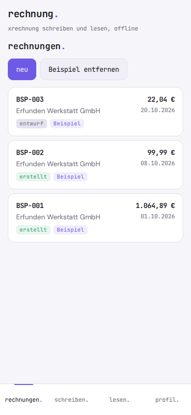
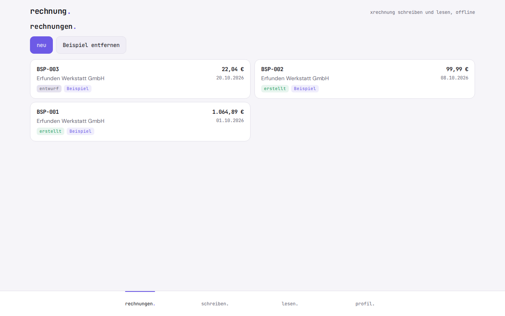

# rechnung.

**E-invoicing without a subscription.** rechnung. writes XRechnung e-invoices, checks the math and shows received ones as a readable invoice. It runs offline in the browser as a PWA, with no account and no server.

XRechnung and ZUGFeRD are the German e-invoice formats based on the EU standard EN 16931: the invoice is a structured XML file instead of a PDF, so the recipient's software can read it. rechnung. is for freelancers and small businesses in Germany who write a few invoices a month or need to read one they received.

   

The app interface is in German.

If you are a freelancer or run a small business and write a few invoices a month, e-invoicing often means paying for an accounting subscription. The free online generators ask you to upload customer and revenue data to someone else's server, and the open-source validators are Java tools for developers. rechnung. only does the "write and read e-invoices" part: one form, one XML file, one pre-check. Plain arithmetic, no AI, no server.

<p align="center">
  
</p>

<p align="center">
  
</p>

## Why

Since 2025, businesses in Germany must be able to receive e-invoices, and later they must issue them too. An e-invoice is XML that you cannot read without a tool and cannot safely write by hand. rechnung. does not replace accounting software such as sevDesk or Lexware Office. It covers only what you need when you write a few invoices a month or want to check one you received.

Small businesses under the German small-business rule (Kleinunternehmer, § 19 UStG) may keep sending paper or PDF invoices. rechnung. does not claim any obligation and does not tell you whether you qualify as a Kleinunternehmer.

## Features

- **Write:** a form for one invoice, output as XRechnung 3.0 in CII syntax (`.xml`, file name taken from the invoice number)
- **Sender profile:** company, address, tax number or VAT ID (Steuernummer or USt-IdNr.), contact, email, IBAN. Set it up once, used for every invoice
- **Customers:** a small list with address, email and buyer reference (Leitweg-ID, the routing ID German public authorities require)
- **Line items** with quantity, unit (piece, hour, day, flat fee), net unit price and VAT rate 19, 7 or 0 % (Kleinunternehmer under § 19 UStG)
- **Live totals** in the form: line totals, tax per rate, net and gross according to EN 16931
- **Invoice number** sequential with a configurable prefix, can be overwritten by hand
- **Read:** open or drop in an XRechnung or ZUGFeRD XML file (CII) or an XRechnung UBL file. It is shown as a normal invoice, the totals are recalculated and differences are marked. Fields rechnung. does not know are shown as a raw list instead of disappearing. The raw XML can be expanded
- **Pre-check** of selected mandatory-field and calculation rules, each with its rule ID and a German hint
- **Print** the readable view through the browser, also as PDF
- **Export and import** of all data as a JSON file
- Sample data to try it out, removable with one click
- Light and dark mode, works offline, installable as an app

## Limits

Being honest about these is part of the tool:

- **The check is a pre-check, not an official validation.** rechnung. checks a selection of the rules (mandatory fields, totals, tax categories, payment instructions, buyer reference, tax number, electronic addresses), but not the full Schematron rule set. A file can pass the pre-check and still be rejected by the recipient. For a binding result, use the KoSIT validator (the official XRechnung validator).
- **The generated files have not yet been run through the KoSIT validator.** This is planned as a manual step before a release and is still open.
- **Reading is only tested with self-written examples.** Tested are two self-written files (CII with a charge, UBL with an allowance) and the round trip of rechnung.'s own CII files. Official examples from the KoSIT test suite are not included yet. Whether files from other software are read correctly is therefore **not tested yet**.
- **No ZUGFeRD PDF.** It does not create a PDF/A-3 with embedded XML and does not read XML out of PDFs. Printing gives a normal PDF.
- When writing: no allowances or charges, no credit notes, no partial or advance invoices, no foreign currency (EUR only), no reverse charge. When reading, document-level allowances and charges are included in the calculation.
- No bookkeeping, no payment reminders, no sending, no Peppol connection, no bank connection.
- No tax advice.
- XRechnung gets new versions regularly. The version identifier used (3.0) is in exactly one place in `logik.js`.

## Privacy

Nothing leaves your device. rechnung. has no server, no account, no analytics, no ads and loads nothing from the network, not even fonts. Profile, customers and invoices are stored only in your browser's local database (IndexedDB). Files you open are processed in the browser. The XML parser rejects DOCTYPE and custom entities, so a foreign file cannot load anything.

Because the data lives only in the browser: if you clear the site data, your invoices are gone too. Export a JSON backup now and then.

## Install

rechnung. is a static web app. There is no build step and there are no dependencies.

1. Put the `rechnung/` folder on any static host (your own web space, GitHub Pages, Netlify, a Raspberry Pi). Installing it as an app needs HTTPS.
2. Open the address in your browser.
3. In the browser menu choose **Zum Startbildschirm hinzufügen** ("Add to Home Screen") or **Installieren** ("Install"). After that rechnung. starts like an app and also works without a network.

Test locally:

```
cd rechnung
python3 -m http.server 8000
```

Then open `http://localhost:8000` in your browser.

Tests (Node 18 or later, no packages needed):

```
node --test
```

## How the math works

All functions are pure functions in `logik.js`. Calculations use `BigInt` with fixed decimal places, never floating point. Amounts, quantities and prices are stored as decimal strings.

**1. Line (BT-131).** Quantity × unit price, rounded commercially to 2 decimals (half away from zero). The unit price itself is not rounded.

**2. Tax per rate (BT-116, BT-117).** Base = sum of the lines with this rate (when reading: minus allowances, plus charges for this rate). Tax = base × rate ÷ 100, rounded to 2 decimals.

**3. Totals.** Net (BT-109) = sum of lines (BT-106) minus allowances plus charges. Total tax (BT-110) = sum of the tax amounts. Gross (BT-112) = net + tax. Amount due = gross minus prepaid amount (BT-115).

**4. Kleinunternehmer.** At 0 %, rechnung. writes tax category E with the exemption reason `Kein Ausweis von Umsatzsteuer, da Kleinunternehmer gemäß § 19 UStG` ("No VAT shown, small business under § 19 UStG"). At 19 and 7 %, category S applies.

**5. Format.** CII according to UN/CEFACT D16B, type 380, currency EUR, payment means 58 (SEPA credit transfer), units H87, HUR, DAY and LS.

**Test vectors to check by hand** (all in `test-calc.js`):

1. 10 × 85.00 (19 %) and 1 × 49.90 (7 %): lines 850.00 and 49.90, tax 161.50 and 3.493 rounded to 3.49, net 899.90, tax 164.99, gross **1064.89**.
2. Kleinunternehmer, 3 × 33.33 (0 %): line 99.99, tax 0.00, gross **99.99**.
3. When reading, 1.5 × 12.345 = 18.5175 rounded to 18.52 (19 %), document allowance 2.00: base 16.52, tax 3.1388 rounded to 3.14, gross **19.66**.
4. Rounding at the boundary: 1 × 0.125 becomes 0.13, 1 × −0.125 becomes −0.13.

**Rules checked** (pre-check, each with rule ID and a German hint): BR-01 to BR-11 and BR-16 (header, seller, buyer, addresses, at least one line item), BR-CO-10, -13, -14, -15, -16 and -25 (totals add up), BR-S-08 and -09, BR-E-08, -09 and -10 (tax base and exemption reason), BR-DE-1 to -9 (payment instructions, seller contact, address), BR-DE-15 (buyer reference), BR-DE-16 (tax number or VAT ID), BR-DE-19 (IBAN checksum), BT-34 and BT-49 (electronic addresses).

The tests cover the vectors, rounding, the XML parser (entities, namespaces, rejected DOCTYPE), the mandatory elements and schema order of the generated file, the write-and-read round trip, reading the examples, and export and import.

## License

GNU Affero General Public License v3.0 (AGPL-3.0), see `LICENSE`.

**Deutsch:** rechnung. schreibt und liest E-Rechnungen (XRechnung, ZUGFeRD-XML) im Browser, rechnet nach und prüft vor, offline, ohne Konto und ohne Abo, für Freiberufler und Kleinunternehmer.

---

**gedacht.gemacht.** Small, honest software. Everything stays on your device. · [More projects](https://github.com/gedachtgemacht)
